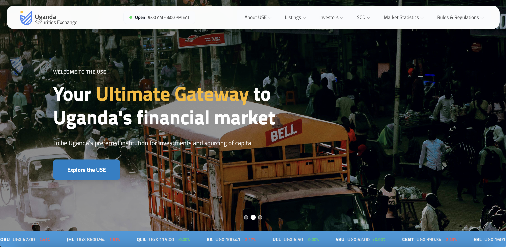

# Uganda Securities Exchange Platform

A modern web platform for the Uganda Securities Exchange, built with Laravel 13.x and featuring a custom dual-structure architecture for easy deployment.

<p align="center">
  
</p>

## Project Overview

This platform provides a comprehensive digital presence for the Uganda Securities Exchange, including:

- **Public Website**: Homepage, securities listings, news articles, events, and annual reports
- **Admin Dashboard**: Content management system for news, events, securities, carousel images, and site settings
- **Authentication**: Email/password and Google OAuth (Google sign-in is limited to existing accounts)
- **Dynamic Menu System**: 3-level hierarchical navigation
- **Securities Management**: Track equities, treasury bills, and treasury bonds with detailed information

## Project Architecture

### Dual-Structure Setup

This project uses a custom file structure designed for simplified deployment:

```
faangsupport/
├── app/                    # Laravel application
│   ├── app/               # Application logic (Models, Controllers)
│   ├── config/            # Configuration files
│   ├── database/          # Migrations, seeders
│   ├── public/            # Laravel public directory
│   ├── resources/         # Views, assets
│   ├── routes/            # Route definitions
│   └── vendor/            # Composer dependencies
├── images/                # Public images (accessible via /images/)
├── uploads/               # User uploads (accessible via /uploads/)
├── css/                   # Static CSS files
├── js/                    # Static JavaScript files
└── index.php              # Static entry point
```

**Key Points:**
- The **root directory** contains static files and serves as the web root
- The **app/ directory** contains the full Laravel application
- Static assets in root directory are directly accessible
- Laravel routes handle dynamic content and admin functionality

## Requirements

- PHP >= 8.3
- MySQL/MariaDB
- Composer (optional, if vendor directory not included)
- Apache/Nginx web server

## Installation

### 1. Clone the Repository

```bash
git clone <repository-url>
cd faangsupport
```

### 2. Install Dependencies (Optional)

If the `vendor/` directory is not included in the repository, install PHP dependencies:

```bash
cd app
composer install
```

### 3. Configure Environment

```bash
# Copy environment file
cp app/.env.example app/.env

# Generate application key
php artisan key:generate
```

### 4. Configure Database

Edit `app/.env` and set your database credentials:

```env
DB_CONNECTION=mysql
DB_HOST=127.0.0.1
DB_PORT=3306
DB_DATABASE=use_db
DB_USERNAME=use_admin
DB_PASSWORD=your_secure_password
```

Create the database:

```bash
mysql -u root -p
CREATE DATABASE use_db;
```

### 5. Run Migrations & Seeders

```bash
cd app

# Run migrations
php artisan migrate

# Seed database with sample data (optional)
php artisan db:seed --class=SecuritySeeder
php artisan db:seed --class=MenuItemSeeder
```

## Deployment

### Option 1: Shared Hosting (Recommended for this structure)

This dual-structure setup is ideal for shared hosting environments:

1. **Upload Files**:
   - Upload all root files (`index.php`, `images/`, `css/`, `js/`, etc.) to `public_html/`
   - Upload the `app/` directory to `public_html/app/`

2. **Configure Web Server**:
   - Point domain root to `public_html/`
   - Ensure `mod_rewrite` is enabled (for Apache)

3. **Set Permissions**:
   ```bash
   chmod -R 755 public_html/
   chmod -R 775 public_html/app/storage
   chmod -R 775 public_html/app/bootstrap/cache
   chmod -R 775 public_html/uploads
   ```

4. **Configure .htaccess** (if using Apache):

   Create/update `public_html/.htaccess`:
   ```apache
   <IfModule mod_rewrite.c>
       RewriteEngine On

       # Redirect to app/public for Laravel routes
       RewriteCond %{REQUEST_URI} !^/app/public
       RewriteRule ^(.*)$ app/public/$1 [L]
   </IfModule>
   ```

5. **Environment Configuration**:
   - Update `app/.env` with production settings
   - Set `APP_ENV=production`
   - Set `APP_DEBUG=false`
   - Update `APP_URL` to your domain

### Option 2: VPS/Cloud Server (Apache)

1. **Clone Repository**:
   ```bash
   cd /var/www/
   git clone <repository-url> use-exchange
   ```

2. **Install Dependencies**:
   ```bash
   cd /var/www/use-exchange/app
   composer install --no-dev --optimize-autoloader
   ```

3. **Configure Apache Virtual Host**:
   ```apache
   <VirtualHost *:80>
       ServerName use.ug
       DocumentRoot /var/www/use-exchange

       <Directory /var/www/use-exchange>
           AllowOverride All
           Require all granted
       </Directory>

       # Laravel routes
       Alias /admin /var/www/use-exchange/app/public
       Alias /api /var/www/use-exchange/app/public

       ErrorLog ${APACHE_LOG_DIR}/use-error.log
       CustomLog ${APACHE_LOG_DIR}/use-access.log combined
   </VirtualHost>
   ```

4. **Set Permissions**:
   ```bash
   sudo chown -R www-data:www-data /var/www/use-exchange
   sudo chmod -R 755 /var/www/use-exchange
   sudo chmod -R 775 /var/www/use-exchange/app/storage
   sudo chmod -R 775 /var/www/use-exchange/app/bootstrap/cache
   ```

5. **Enable Site & Restart**:
   ```bash
   sudo a2ensite use-exchange.conf
   sudo a2enmod rewrite
   sudo systemctl restart apache2
   ```

### Option 3: VPS/Cloud Server (Nginx)

1. **Configure Nginx**:
   ```nginx
   server {
       listen 80;
       server_name use.ug;
       root /var/www/use-exchange;
       index index.php index.html;

       # Static files from root
       location ~* \.(jpg|jpeg|png|gif|ico|css|js|svg|webp)$ {
           try_files $uri $uri/ =404;
       }

       # Admin and API routes to Laravel
       location ~ ^/(admin|api|auth|manage|securities|news) {
           root /var/www/use-exchange/app/public;
           try_files $uri $uri/ /app/public/index.php?$query_string;

           location ~ \.php$ {
               fastcgi_pass unix:/var/run/php/php7.4-fpm.sock;
               fastcgi_index index.php;
               fastcgi_param SCRIPT_FILENAME $document_root$fastcgi_script_name;
               include fastcgi_params;
           }
       }

       # Default to static files
       location / {
           try_files $uri $uri/ /index.html =404;
       }
   }
   ```

2. **Restart Nginx**:
   ```bash
   sudo systemctl restart nginx
   ```

## File Serving Routes

The application serves uploaded files via Laravel routes:

- **Uploads**: `/uploads/{filename}` → serves from root `uploads/` directory
- **Images**: `/images/{filename}` → serves from root `images/` directory

These routes are defined in `app/routes/web.php`.

## Key Features

### Public Routes
- `/` - Homepage with carousel, news, and events
- `/securities` - Listed securities
- `/securities/{symbol}` - Security details
- `/news/{id}` - News article
- `/about` - About page
- `/annual-reports` - Annual reports listing

### Admin Routes (Protected)
- `/admin/news` - News management
- `/admin/events` - Events management
- `/admin/securities` - Securities management
- `/admin/carousel-images` - Homepage carousel
- `/admin/site-content` - Site settings
- `/admin/menu-items` - Navigation menu management
- `/admin/files` - File uploads

### Authentication Routes
- `/login` - User login
- `/register` - User registration
- `/auth/google` - Google OAuth login (existing accounts only)
- `/logout` - Logout (POST only)

## Development

### Local Development Server

```bash
cd app
php artisan serve
```

Visit `http://localhost:8000`

### Running Tests

Feature tests run against a MySQL/MariaDB database loaded from `use_db.sql`:

```bash
mysql -e "CREATE DATABASE use_test"
mysql use_test < use_db.sql
cd app
DB_USERNAME=<user> DB_PASSWORD=<password> vendor/bin/phpunit
```

### Clear Cache

```bash
cd app
php artisan cache:clear
php artisan config:clear
php artisan view:clear
```

## Database Structure

### Core Tables
- `securities` - Listed securities (equities, treasury bills, bonds)
- `news` - News articles
- `news_security` - Many-to-many relationship between news and securities
- `events` - Market events and announcements
- `carousel_images` - Homepage carousel slides
- `site_contents` - Dynamic site settings (key-value pairs)
- `menu_items` - Navigation menu with 3-level hierarchy
- `files` - File uploads
- `users` - User accounts
- `subscribers` - Newsletter subscribers

## Admin Middleware

**Important**: Currently, admin routes are not protected by middleware. To add authentication protection:

1. Create admin middleware:
   ```bash
   cd app
   php artisan make:middleware AdminMiddleware
   ```

2. Register in `app/Http/Kernel.php`

3. Apply to admin routes in `app/routes/web.php`

## Troubleshooting

### Images Not Loading

- Verify file paths: `/images/` and `/uploads/` should map to root directories
- Check file permissions: `chmod 755 images/ uploads/`
- Confirm web server configuration allows directory access

### Laravel Routes Not Working

- Enable `mod_rewrite` (Apache)
- Verify `.htaccess` exists in `app/public/`
- Check web server error logs

### Database Connection Failed

- Verify database credentials in `app/.env`
- Ensure MySQL/MariaDB is running
- Check database exists: `SHOW DATABASES;`

## Security Notes

- Change all default credentials in production
- Set `APP_DEBUG=false` in production
- Use HTTPS (SSL certificate) for production
- Implement admin middleware for `/admin` routes
- Regularly update dependencies: `composer update`
- Keep `APP_DEBUG=false` in production: `vendor/` includes dev tools (Ignition) that are only safe with debug off

## Contributing

1. Fork the repository
2. Create a feature branch
3. Commit your changes
4. Push to the branch
5. Open a Pull Request

## License

Proprietary - Uganda Securities Exchange

## Support

For technical support or questions, contact duncanmudulo@gmail.com